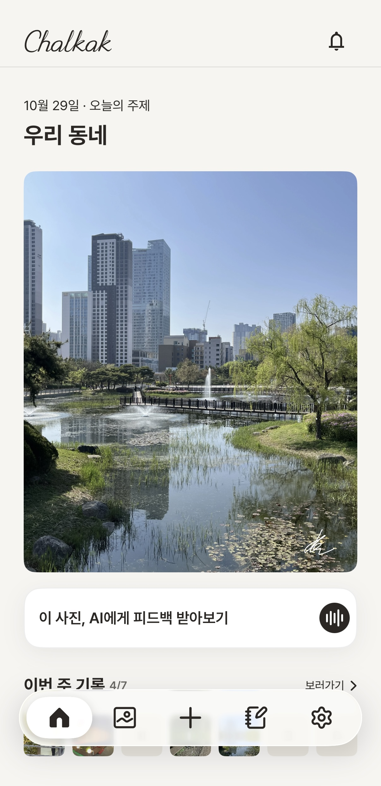
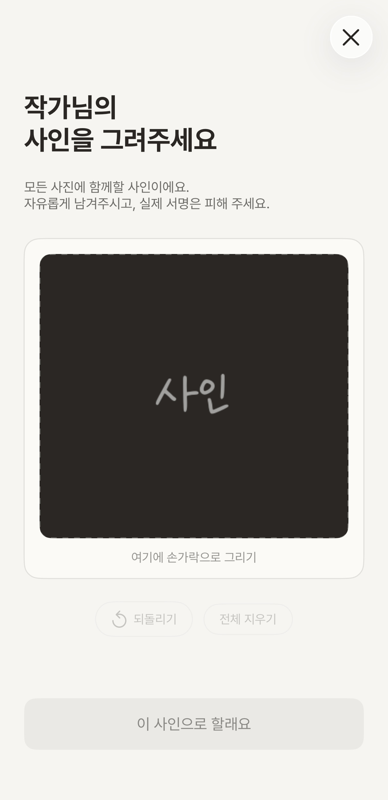
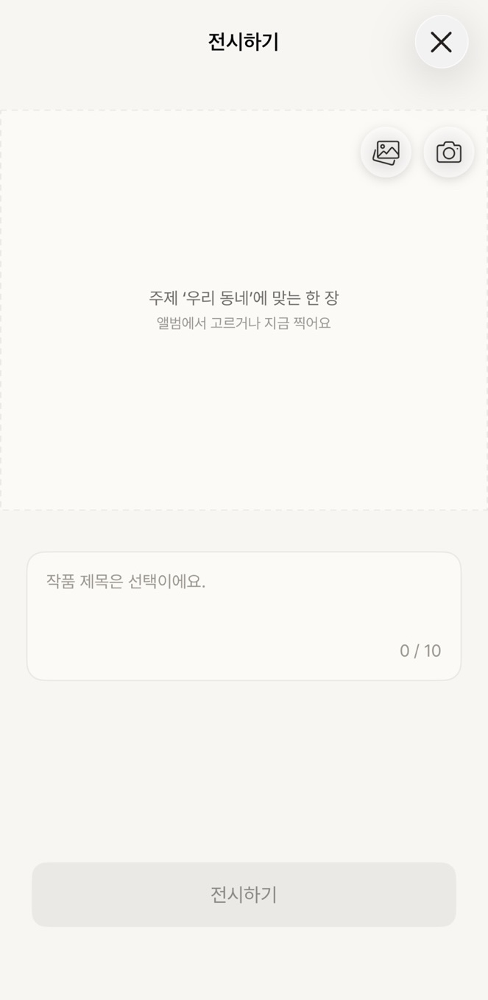
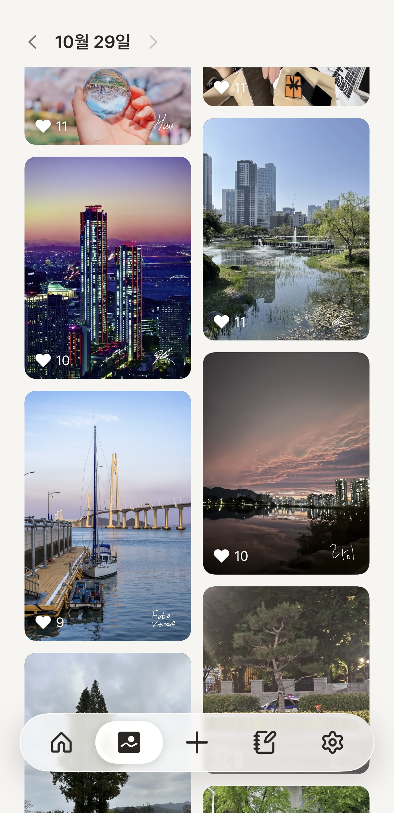
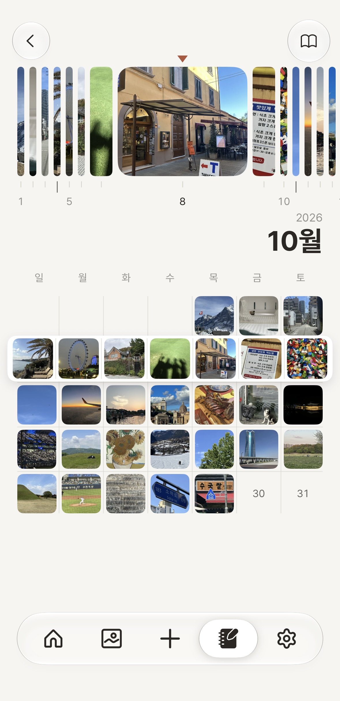
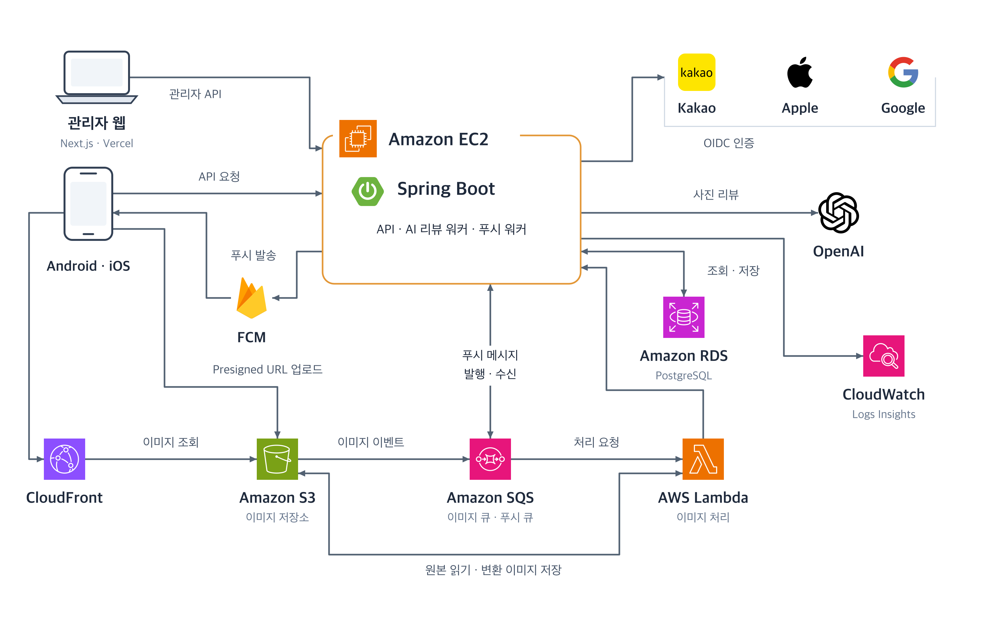
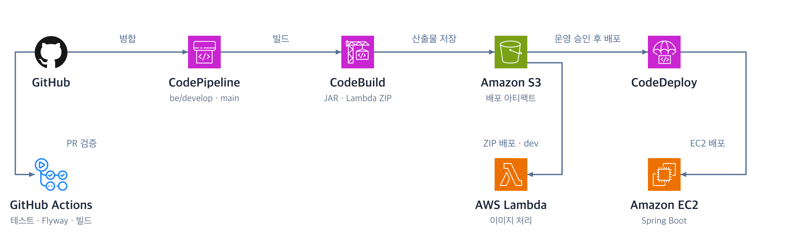
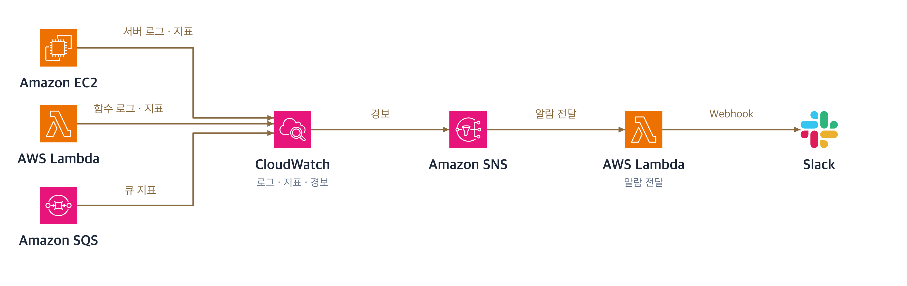

# 찰캌

**매일 같은 주제로 사진을 공유하며, 나만의 사인으로 개성을 남기는 익명 사진 서비스.**

[App Store](https://apps.apple.com/kr/app/%EC%B0%B0%EC%BA%8C-%EB%A7%A4%EC%9D%BC-%ED%95%98%EB%82%98%EC%9D%98-%EC%A3%BC%EC%A0%9C-%EA%B0%81%EC%9E%90%EC%9D%98-%ED%95%9C-%EC%9E%A5/id6809104229) · [Google Play](https://play.google.com/store/apps/details?id=com.stonefive.chalkak)

## 만든 이유

사진 촬영이 익숙하지 않은 사람도 꾸준히 사진을 찍을 수 있도록 매일 하나의 주제를 제공합니다. 같은 주제를 다른 사람들은 어떻게 표현했는지 감상하며, 사진을 보는 시각과 촬영 실력을 키울 수 있도록 기획했습니다.

## 주요 기능

  
  &nbsp;
  
  &nbsp;
  
  &nbsp;
  
  &nbsp;
  

왼쪽부터 오늘의 주제 · 나만의 사인 · 사진 전시 · 사진 감상 · 사진 기록. iOS 앱 화면입니다.

- **오늘의 주제** — 매일 하나의 주제로 사진에 담을 새로운 순간을 찾습니다.
- **나만의 사인** — 직접 그린 사인을 사진에 남겨 개성을 표현합니다.
- **사진 전시·감상** — 주제에 맞는 사진을 공유하고, 다른 사람의 시선을 감상하며 좋아요를 남깁니다.
- **사진 기록** — 달력에서 날짜별 사진을 돌아보며 일상을 기록합니다.
- **AI 피드백** — 전시한 사진에 대한 피드백을 받아봅니다.

## 개발 기간 및 팀 구성

**2026.08 ~ 진행 중** · 총 5명 (Backend 3명, Mobile 2명)

| [루크 (이성민)](https://github.com/smiinii) | [에버 (조성진)](https://github.com/Chocoding1) | [아론 (이선욱)](https://github.com/sun007021) | [볼트 (정찬)](https://github.com/cksckckcks) | [커비 (이현우)](https://github.com/cbnuleehyunwoo) |
| :---: | :---: | :---: | :---: | :---: |
|  |  |  |  |  |
| Backend | Backend | Backend | Mobile | Mobile |

## 기술 스택

| 영역 | 사용 기술 |
| --- | --- |
| Android | Kotlin, Jetpack Compose, Coroutines, Retrofit, Coil |
| iOS | Swift, SwiftUI |
| Backend | Java, Spring Boot, Spring Data JPA, Spring Security, Flyway |
| Database | PostgreSQL, Amazon RDS |
| 이미지 처리 | Amazon S3, CloudFront, SQS, AWS Lambda |
| 외부 연동 | OpenAI, Firebase Cloud Messaging, Kakao · Apple · Google OIDC |
| 배포 | GitHub Actions, CodePipeline, CodeBuild, CodeDeploy, Amazon EC2 |
| 모니터링 | CloudWatch, Amazon SNS, AWS Lambda, Slack |

## 아키텍처

### 서비스

### 배포

### 모니터링

### Android

Android 앱 아키텍처는 준비 중입니다.

<!-- Android 아키텍처 완성 후 다이어그램과 주요 계층·데이터 흐름 설명을 추가합니다. -->
