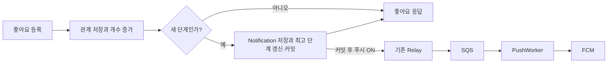

# 좋아요 달성 알림의 DB와 처리 흐름

- 기준: [이슈 #864](https://github.com/woowacourse-teams/2026-Chalkak/issues/864), [PR #914](https://github.com/woowacourse-teams/2026-Chalkak/pull/914). 기능 구현 `c965cfb7`, 개발 브랜치 통합·검증 `e2d45e3f`
- 상태: 2026-11-03 로컬 구현·검증 완료. 서버 미배포, 실제 기기 수신·앱 연동 미검증
- 정책 원본: [LIKE-006](../../../docs/business-rules/rules/like.md#like-006-좋아요-달성-단계와-중복-생성-방지), [NOTIFICATION-006·017](../../../docs/business-rules/rules/notification.md)

## 처리한 단계와 발송 상태를 나눠 저장한다

| 테이블 | 저장하는 정보 | 이번 변경 |
| --- | --- | --- |
| `post_likes` | 회원·게시물의 좋아요 관계 | 없음. 실제 신규 등록일 때만 후속 처리 |
| `post_like_counts` | 현재 개수와 처리한 최고 단계 | `last_milestone_count` 추가 |
| `users` | 회원별 좋아요 푸시 수신 여부 | `like_push_enabled` 추가 |
| `notifications` | 알림함 내용·읽음·SQS 발행 상태 | `POST_LIKE_MILESTONE` 종류 추가, 기존 컬럼 재사용 |
| `push_deliveries` | 사건·회원별 기기 발송 시작·결과·완료 | 기존 구조 재사용 |

별도 마일스톤 테이블과 전용 Relay는 사용하지 않는다. 좋아요 단계 숫자를 위한 Notification 컬럼이나 FCM data 필드도 추가하지 않는다.

관계는 `posts`와 `post_like_counts`가 1:1, `users`와 `notifications`가 1:N이다. `post_likes`의 `UNIQUE(post_id, user_id)`로 같은 회원의 중복 좋아요를 막는다. 카운트의 `post_id`는 게시물 FK(`ON DELETE RESTRICT`)이며, Notification의 게시물 연결은 기존 범용 `source_type`·`source_id`를 사용해 게시물 FK를 새로 추가하지 않는다.

### `post_like_counts`

| 컬럼 | 타입·기본값 | 의미 |
| --- | --- | --- |
| `post_id` | `UUID`, 기존 PK | 게시물별 한 행 |
| `like_count` | `BIGINT`, 기존 컬럼 | 현재 좋아요 수 |
| `last_milestone_count` | `BIGINT NOT NULL DEFAULT 0` | 처리한 최고 단계. 도입 당시 기준 단계도 포함 |

최고 단계는 0 이상의 5의 배수로 제한하고 갱신할 때는 기존 값보다 클 때만 UPDATE한다. 좋아요 취소·개수 초기화·재집계로 낮추지 않는다. 현재 개수가 4여도 최고 단계가 5일 수 있으므로 `last_milestone_count <= like_count` 제약은 두지 않는다.

최고 단계는 보통 **알림 생성 완료**를 뜻하며 푸시 성공을 뜻하지 않는다. 예외는 최초 도입의 기준값 초기화와 1차 호환 배포 준비 기간이며 이때는 알림을 만들지 않는다. 알림함을 30일 뒤 지워도 최고 단계는 게시물의 카운트 행에 남는다.

### `users`와 `notifications`

`users.like_push_enabled`는 `BOOLEAN NOT NULL DEFAULT TRUE`다. Java 신규 회원 기본값과 기존 회원의 마이그레이션 초기값도 true다.

| Notification 컬럼 | 좋아요 알림의 값 |
| --- | --- |
| `id` | DB가 생성한 알림 ID. SQS의 `notificationId` |
| `user_id` | 게시물 작성자 |
| `event_key` | 게시물 ID·단계로 결정한 사건 UUID. SQS의 `eventId` |
| `type` | `POST_LIKE_MILESTONE` |
| `source_type` / `source_id` | `POST` / 게시물 ID |
| `title` / `body` | 생성 시 확정한 문구. 이후 좋아요 감소로 변경하지 않음 |
| `payload` / `read_at` | 최초 null. 반려 사유 없음, 읽음은 기존 API로 기록 |
| `created_at` | 알림 생성 시각. 30분 푸시 기한·30일 알림 보관의 기준 |
| `sqs_publish_status` | 설정 ON이면 `PENDING`, OFF이면 `NOT_REQUIRED` |
| `next_attempt_at` | `PENDING` 최초에는 생성 시각. 일시 실패·결과 불명은 1분 뒤 |
| `sqs_published_at` | SQS 수락 확인 시각. 최초에는 null |

기존 `UNIQUE(user_id, event_key)`를 재사용한다. 새 CHECK 제약은 좋아요 알림의 `source_type=POST`와 `source_id IS NOT NULL`을 요구한다. 공통 발행 대기는 `(next_attempt_at, id) WHERE sqs_publish_status = 'PENDING'` 부분 인덱스를 사용한다. 기존 회원별 최신순·미읽음 인덱스도 그대로 사용하며 좋아요 전용 인덱스는 추가하지 않는다.

## 신규 좋아요부터 푸시까지

아래는 기능 활성화 이후 흐름이다. 현재 1차 버전은 `NOTIFICATION_LIKE_MILESTONE_ENABLED=false`로 최고 단계까지만 갱신하고 알림 생성을 막는다. Worker는 스위치와 무관하게 새 타입을 처리할 수 있다. [1차 배포·2차 활성화 절차](../../deploy/docs/like-milestone-rollout.md)를 따른다.

`PostLikeService`는 실제 좋아요가 추가됐을 때만 `LikeMilestonePolicy.calculateCandidate()`를 호출한다. 정책 클래스는 5개 간격 계산과 유효 단계 검증을 공유하며 객체나 Spring 빈을 만들지 않는다. Notification 생성 경계에서도 같은 정책으로 검증한다.

기존 카운트 증가 UPDATE가 같은 게시물의 카운트 행을 잠그고 트랜잭션 종료까지 유지한다. 최고 단계는 저장된 값보다 후보가 클 때만 조건부 UPDATE하며, 1행을 갱신했을 때만 Notification을 생성한다. 최고 단계 SELECT를 별도로 실행하지 않으며 알림 저장에 실패하면 최고 단계 갱신도 롤백한다. 마일스톤 때문에 게시물 `FOR UPDATE`를 추가하지 않는다. 기존 게시물 조회의 공유 잠금은 유지한다. 같은 게시물의 카운트 UPDATE 대기는 여전히 존재한다.

좋아요 관계·카운트·Notification·최고 단계 중 하나라도 저장에 실패하면 전체를 롤백한다. `createForLikeMilestone()`은 호출한 좋아요 트랜잭션에 반드시 참여한다. 이 트랜잭션 안에서는 SQS나 FCM을 호출하지 않는다.

## 공통 Relay·Worker가 처리한다

Relay는 한 실행에 발행 가능 알림 최대 100건을 처리하고 종료 후 1초 쉬는 기존 구조다. 좋아요 알림도 같은 배치에 포함하며 별도 커서·스레드·큐는 추가하지 않는다.

| 발행 결과 | Notification 상태 |
| --- | --- |
| SQS 수락 확인 | `PUBLISHED`, 수락 시각 기록 |
| 일시 실패·수락 여부 불명 | `PENDING`, 시도 종료 후 1분 뒤 재시도 |
| 영구 오류 | `FAILED` |
| 생성 후 30분 정각부터 | `EXPIRED` |

상태는 SQS 전달 여부다. 기기별 FCM 결과는 `push_deliveries`에서 관리한다. SQS에 저장됐지만 DB에 아직 반영하지 못한 경우를 허용하기 위해 Worker는 `PENDING`과 `PUBLISHED`를 발송 가능한 상태로 본다.

Worker는 최신 설정·읽음·기한·메시지 일치·회원·로그인·기기와 게시물 노출 가능 여부를 확인한다. 좋아요 알림의 승인 상태와 게시물·주제·사진·작성자 삭제 여부는 Notification 조회에 통합해 기기별 게시물 추가 조회를 하지 않는다. 이 조회에서 제외되면 `NOTIFICATION_UNAVAILABLE`로 기록하며, 승인·반려·AI 리뷰의 기존 발송 조건은 유지한다. 현재 좋아요 수는 다시 조회하지 않는다. 여러 기기의 수락·부분 실패·재시도는 기존 발송 이력을 사용한다. JVM 내 중복 작업은 기존 사건·회원 락을 공유하지만 다중 프로세스와 FCM 결과 불명 상황까지 정확히 한 번을 보장하지 않는다.

## 도입·검증과 운영 확인

[설정 마이그레이션](../../src/main/resources/db/migration/V202611032315__add_like_push_setting.sql)과 [알림함 통합 마이그레이션](../../src/main/resources/db/migration/V202611032316__integrate_like_milestone_notifications.sql)을 적용한다. 기존 좋아요가 17개라면 최고 단계만 15로 초기화하며 Notification이나 SQS 메시지를 만들지 않는다. 신규 행은 0부터 시작한다.

푸시 전용 초안은 서버에 배포하지 않았으므로 미사용 전용 테이블의 생성·삭제 마이그레이션은 포함하지 않는다. 기존 마일스톤 데이터 이관은 필요하지 않다. 로컬에 초안을 적용한 DB는 별도로 정리하며 공유·운영 DB의 Flyway 이력을 변경하지 않는다. 공통 구버전의 새 타입 조회·메시지 처리 오류를 막기 위해 1차에는 임시 생성 스위치를 추가한다. 개발·운영의 1차 배포·구버전 종료·최고 단계 보정 완료 후 2차에서 조건문과 설정을 제거하며, 제거 코드는 이번에 구현하지 않는다.

검증은 로컬 PostgreSQL과 모의 외부 발송으로 수행했다. 기능 구현 시 전체 테스트 3,748개가 통과했고, 개발 브랜치 통합 커밋 `e2d45e3f`에서는 전체 테스트 3,813개·아키텍처 12개·환경변수·컨벤션 검사가 통과했다. 이는 해당 커밋의 검증 결과이며 이후 리뷰 수정의 검증 결과는 PR에서 구분해 기록한다. 관련 테스트는 [단계 정책](../../src/test/java/com/chalkak/backend/notification/domain/LikeMilestonePolicyTest.java), [동시성·롤백](../../src/test/java/com/chalkak/backend/like/service/PostLikeMilestoneConcurrencyTest.java), [최고 단계 초기화](../../src/test/java/com/chalkak/backend/like/infrastructure/persistence/PostLikeMilestoneMigrationTest.java), [Worker](../../src/test/java/com/chalkak/backend/notification/service/PostLikeMilestonePushWorkerTest.java)에서 확인한다.

배포 후에는 새 단계·OFF·읽음 선처리·게시물 삭제·다중 기기를 실제 SQS·FCM과 연결해 확인한다. 기존 [알림 조사 절차](../../deploy/docs/notification-investigation.md)와 [모니터링 안내](../../deploy/docs/notification-monitoring.md)를 따라 공통 Relay 로그·DB 발행 대기·Worker 생략 사유·오류 경보·DLQ를 확인한다. 기존 모니터링 코드를 재사용했다는 사실과 실제 AWS 설정의 검증 완료는 구분한다.

새 종류의 알림이 저장된 뒤 이전 enum이 없는 서버 코드로 되돌리면 조회가 실패할 수 있으므로 롤백 전에 DB·큐의 새 타입 호환성을 확인한다. 앱은 [푸시 계약](../../../docs/business-rules/guides/notification-push-contract.md)의 `POST_LIKE_MILESTONE`과 `likePushEnabled`, 게시물 이동·읽음을 함께 처리해야 한다.

## Android·iOS 팀에 수동으로 전달할 문구

아래 계약은 활성화 이후 기준이다. PR #914의 1차 호환 배포에서는 좋아요 알림을 생성하지 않으며, 개발·운영의 1차 완료 후 별도 2차 배포에서 활성화한다. 서버 스위치와 회원별 `likePushEnabled`를 구분하고, 앱의 새 종류·설정 지원을 활성화 전에 준비한다.

> #864에서 좋아요 달성 알림을 추가했습니다(LIKE-006, NOTIFICATION-006·017). 알림함·푸시에 `POST_LIKE_MILESTONE`이 올 수 있으며 `sourceType=POST`, `sourceId=게시물 ID`로 게시물 상세에 연결하고 알림 ID로 읽음 처리해 주세요. 설정 GET·PATCH에 `likePushEnabled`를 추가했고 기존·신규 회원 모두 최초 true입니다. 누락·null은 기존 값을 유지하며 전체 설정 토글은 네 필드를 함께 보내야 합니다. 좋아요 푸시를 꺼도 알림함은 생성하고 다시 켜도 지난 알림을 소급 푸시하지 않습니다. 새 종류·설정 화면·부분 수정·기존 앱의 알 수 없는 종류 처리와 실제 기기 수신을 확인해 주세요. [백엔드 PR #914](https://github.com/woowacourse-teams/2026-Chalkak/pull/914), 개발 브랜치 통합 커밋 `e2d45e3f`에서 로컬 검증을 완료했으며 서버 미배포 상태입니다. 리뷰 수정은 진행 중이며 공통 하네스 재배포 버전은 미확인입니다. 앱 연동 계약은 공통 푸시·알림함 안내를 참고해 주세요.

## Notion 수동 반영

공통 위치는 `찰캌 → 백엔드 → 비즈니스 룰 → 백엔드 비지니스 룰`이다. 아래 원본 규칙의 해당 절 전체가 복사할 완성 문구이며, 다른 규칙과 순서는 유지한다. 결정 기록과 이 구현 안내는 Notion 현재 규칙에 복사하지 않는다.

| 위치 | 작업 | 복사할 완성 문구 |
| --- | --- | --- |
| 좋아요 → 좋아요 달성 알림 | 새 페이지에 추가 | [LIKE-006 전체](../../../docs/business-rules/rules/like.md#like-006-좋아요-달성-단계와-중복-생성-방지) |
| 알림함 → 푸시 수신 설정 | 기존 해당 규칙 교체 | [NOTIFICATION-006 전체](../../../docs/business-rules/rules/notification.md#notification-006-본인-푸시-수신-설정-조회수정) |
| 알림함 → 좋아요 달성 알림 | 새 페이지에 추가 | [NOTIFICATION-017 전체](../../../docs/business-rules/rules/notification.md#notification-017-좋아요-달성-알림함과-푸시) |

좋아요 달성의 서버 미배포 상태도 함께 알린다. Notion·팀 채널에는 자동 반영하거나 발송하지 않았다.
